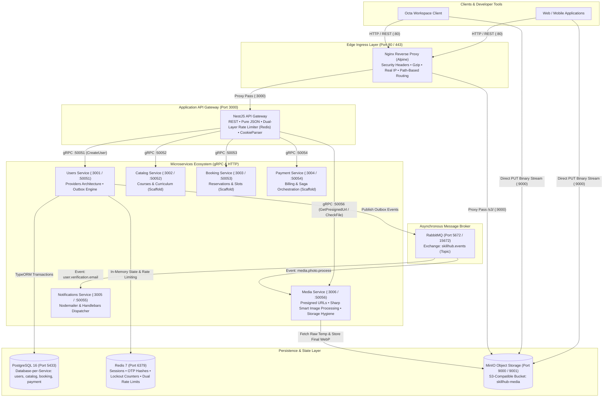

# 🚀 SkillUp (SkillHub) — Cloud-Native Microservices Platform

**SkillUp** is an enterprise-grade, high-performance educational platform architected as a distributed microservices system inside an **Nx Monorepo** powered by **NestJS** and **TypeScript**. Designed from the ground up for extreme **scalability**, fault tolerance, and hardened security, the platform adheres to modern distributed systems design principles including **Edge Ingress Proxying (Nginx)**, **gRPC inter-service communication**, **Event-Driven Architecture (EDA)**, **Transactional Outbox Pattern**, **Direct-to-Storage Upload Pattern (Presigned URLs)**, **Dual-Layer Edge Rate Limiting (IP + Target Defense)**, **Anti-IP Spoofing Defense**, **Timing Attack Defense**, **Atomic Multi-Device Session Management (Redis Lua)**, **Automated Test Coverage (83/83 Tests, 100% Pass Rate)**, and **Database-per-Service**.

---

## 📑 Table of Contents
1. [System Architecture](#1-system-architecture)
2. [Microservices & Infrastructure Inventory](#2-microservices--infrastructure-inventory)
3. [Architectural Design Patterns](#3-architectural-design-patterns)
4. [Direct-to-Storage & Media Pipeline](#4-direct-to-storage--media-pipeline)
5. [Security & Abuse Prevention Architecture](#5-security--abuse-prevention-architecture)
6. [API Reference (Implemented Endpoints)](#6-api-reference-implemented-endpoints)
7. [Automated Test Suite & Security Audit (100% Pass Rate)](#7-automated-test-suite--security-audit-100-pass-rate)
8. [Roadmap & Implementation Progress](#8-roadmap--implementation-progress)
9. [Local Setup & Deployment](#9-local-setup--deployment)
10. [Developer Tooling: Octa Workspace](#10-developer-tooling-octa-workspace)

---

## 1. System Architecture

The platform decouples edge networking, application routing, core domain logic, asynchronous background tasks, and high-speed in-memory state:
- **Edge Reverse Proxy & Ingress (Nginx Alpine):** Unified entrance on port 80/443 providing SSL termination, request buffering, gzip compression, HTTP/2 & WebSocket upgrades, security headers (`X-Frame-Options`, `X-Content-Type-Options`), path-based routing (`/` $\rightarrow$ Gateway, `/s3/` $\rightarrow$ MinIO), and transparent client IP preservation (`X-Forwarded-For`, `X-Real-IP`).
- **Application API Gateway:** The single public REST entrypoint handling edge HTTP/REST traffic, cookie management, pure JSON request validation, Dual-Layer Rate Limiting via Redis, and internal gRPC routing. Zero file buffers pass through the gateway.
- **Internal Services:** Inter-service communication is powered by **gRPC over HTTP/2 with Protocol Buffers**, minimizing network serialization overhead and latency.
- **Direct-to-Storage Ingestion:** Clients stream heavy multimedia directly to **MinIO (S3)** via short-lived, cryptographically signed **Presigned URLs**, offloading heavy I/O and RAM consumption from application servers.
- **Asynchronous Event Pipeline:** Long-running, compute-heavy, and network I/O operations (image smart cropping/resizing and email dispatch) are completely decoupled through **RabbitMQ** and the **Transactional Outbox Pattern**.
- **In-Memory Cache & Security Layer:** **Redis** handles ephemeral state: cryptographic OTP hashes, atomic dual-layer rate limiters, abuse prevention locks, and active multi-device sessions.



---

## 2. Microservices & Infrastructure Inventory

### A. Application Services
| Service | Stack & Protocols | Responsibilities | Current Status |
| :--- | :--- | :--- | :---: |
| **Nginx Ingress** | Nginx Alpine, Reverse Proxy, Gzip | Public edge ingress (ports 80/443), client IP forwarding (`X-Real-IP`, `X-Forwarded-For`), security headers, path-based routing to Gateway and S3 storage. | **Active & Production-Ready** |
| **API Gateway** | NestJS, Express, gRPC Client, Redis, Class-Validator | Public REST API, Dual-Layer Rate Limiting Guard (IP + Target Defense), Anti-IP Spoofing, global exception filters, strict JSON validation pipes, cookie parsing, gRPC client dispatch. Zero Multer/buffer dependencies. | **Active & Production-Ready** |
| **Users Service** | NestJS, TypeORM, gRPC Server, Redis, Modular Providers | Decomposed domain providers architecture, user identity lifecycle, dual-identifier authentication (email/username), timing attack mitigation, bcrypt hashing, dual-token generation, atomic multi-device session management (Redis Lua), Transactional Outbox engine. | **Active & Production-Ready** |
| **Media Service** | NestJS, gRPC Server, Sharp, MinIO S3 SDK, RabbitMQ, Redis | Dual interface: **gRPC** for presigned URLs & file verification; **RabbitMQ Consumer** for asynchronous image smart-cropping, WebP optimization, and temp file purges; **TempCleanupService** for 2-hour storage hygiene. | **Active & Production-Ready** |
| **Notifications Service** | NestJS, Nodemailer, Handlebars, RabbitMQ | Consumes email events, compiles Handlebars email templates, handles SMTP dispatch with retry logic. | **Active & Production-Ready** |
| **Catalog Service** | NestJS, gRPC | Educational course catalog, lessons, curriculum structure, search index. | Skeleton Scaffold |
| **Booking Service** | NestJS, gRPC | Course seat reservations, schedule locks, concurrency control. | Skeleton Scaffold |
| **Payment Service** | NestJS, gRPC | Payment gateways, transaction outbox, distributed Saga compensation. | Skeleton Scaffold |

### B. Backing Infrastructure
- **PostgreSQL 16 (Alpine):** Isolated databases per service: `skillhub_users`, `skillhub_catalog`, `skillhub_booking`, `skillhub_payment`.
- **Redis 7 (Alpine):** In-memory session hashes, token revocation, OTP cryptographic hashes, atomic IP + Email rate limiting counters, and 15-minute lockouts.
- **RabbitMQ 3 (Management Alpine):** Reliable AMQP topic exchange (`skillhub.events`) with durable queues and acknowledgments.
- **MinIO Object Storage:** Self-hosted S3-compatible storage cluster with public read policy for published media (`avatars/*`), private staging (`temp_uploads/*`), and automated cleanup.
- **Nginx (Alpine):** Reverse proxy ingress handling `/healthz`, `/s3/`, `/minio-console/`, and root `/` proxy pass to the API Gateway.

---

## 3. Architectural Design Patterns

### 1. Modular Providers Architecture & Facade Pattern
* **The Problem:** In microservices, putting all endpoint logic in a monolithic service file (`*.service.ts`) creates massive code clutter, violates the Single Responsibility Principle (SRP), and complicates testing.
* **The Solution:**
  1. Every microservice domain decomposes its business logic into specialized, single-purpose **Providers** inside a `providers/` directory categorized by endpoint function.
  2. The parent `*.service.ts` acts as a clean, lightweight **Facade**, delegating incoming requests to the responsible Provider without breaking existing interfaces or controller bindings.
  3. Controllers remain ultra-thin routing layers handling only HTTP transport, cookies, and status codes.

```
apps/users-service/src/providers/
├── register.provider.ts            # User registration, bcrypt hashing, Outbox events
├── verify-account.provider.ts      # OTP verification, 7-attempt lockout, multi-device sessions
├── verification-code.provider.ts   # OTP re-issuing & 60s cooldown checks
├── login.provider.ts               # Dual-identifier login, timing defense, brute-force lockout
├── user-query.provider.ts          # Find by ID & authentication credentials query
├── password-management.provider.ts # Profile updates & password management
└── index.ts

apps/api-gateway/src/users/providers/
├── registration.provider.ts        # Avatar validation & gRPC user dispatch
├── account-verification.provider.ts# Auto-login token extraction & lockout handling
├── verification-code.provider.ts   # Cooldown enforcement & code re-issuance
├── login.provider.ts               # Login gRPC dispatch & HTTP exception mapping
└── index.ts

apps/api-gateway/src/media/providers/
├── upload-url.provider.ts          # Presigned S3 PUT URL generation
├── file-query.provider.ts          # Object verification & URL retrieval
└── index.ts
```

### 2. Transactional Outbox Pattern
* **The Problem:** In distributed architectures, updating a relational database and publishing an event to a message broker within the same execution cycle creates a dual-write problem. If the message broker is unreachable, the event is lost.
* **The Solution:** The user entity and the event payload are written atomically to `users` and `outbox_messages` tables inside a single database transaction (`queryRunner`).
* A background `OutboxWorker` reads pending messages using `SELECT ... FOR UPDATE SKIP LOCKED`, publishes them to RabbitMQ, and marks them as `PUBLISHED` only after acknowledgment, guaranteeing **At-Least-Once Delivery**.

### 3. Direct-to-Storage Upload Pattern (Presigned URLs)
* **The Problem:** Uploading media files through an API Gateway causes server memory bloat, high CPU utilization during multipart parsing (Multer), and network bottlenecks.
* **The Solution:**
  1. The client requests a cryptographically signed PUT URL from `POST /api/v1/media/avatar/upload-url`.
  2. The client streams the raw binary file directly to MinIO Object Storage under `temp_uploads/avatars/{uuid}_{filename}`.
  3. The client submits a pure JSON registration payload containing `tempPhotoKey`.
  4. The API Gateway verifies the file exists and validates content length (1KB - 5MB) via high-speed gRPC (`CheckFileExists`) without loading the image buffer into memory.

### 4. Distributed Multi-Device Session Management & Atomic Eviction (Redis Lua Engine)
* Active sessions are tracked inside Redis Hash structures: `session:{sessionId}` (7 days TTL) containing:
  - `userId`, `hashedRefreshToken` (salted bcrypt hash, cost 10), `ipAddress`, `userAgent`, `createdAt`
* Every user maintains a **Redis Sorted Set** (`user_sessions:{userId}`) storing timestamps as scores.
* The system enforces a strict **maximum of 5 active devices/sessions** per user.
* **Atomic Single-Roundtrip Eviction (Lua Engine):** Storing the session hash, setting TTL, updating the ZSet, and purging excess sessions exceeding the 5-device limit are executed in a single atomic Lua script (`saveSessionWithEviction`), completely preventing race conditions under concurrent logins. When a 6th session is registered, the oldest session is atomically deleted from Redis.
* **Uniform Hashing Across Auth Flows:** Both account verification (`verify-account.provider.ts`) and direct login (`login.provider.ts`) adhere to the same bcrypt standard, keeping all Redis session hashes uniform.

### 5. Application-Side UUID Generation (Single-Roundtrip Storage Determinism)
* The user `id` (`UUIDv4`) is generated at the application layer via `crypto.randomUUID()` prior to database persistence.
* **Architectural Advantage:** Knowing the `userId` in advance allows constructing deterministic S3 storage paths (`avatars/{userId}/avatar.webp`) and populating both the `users` table and the `outbox_messages` payload in a single `INSERT` operation, eliminating secondary `UPDATE` round-trips to PostgreSQL.

---

## 4. Direct-to-Storage & Media Pipeline

```
[Client]                      [Gateway]                    [Media Service]                    [MinIO Storage]
   │                              │                               │                                  │
   │── 1. POST /avatar/upload-url ─►│                               │                                  │
   │                              │── 2. gRPC GetPresignedUrl ───►│                                  │
   │                              │                               │── 3. Generate Signed S3 URL ────►│
   │                              │◄── 4. Returns { uploadUrl } ──│                                  │
   │◄── 5. Returns { uploadUrl } ─│                               │                                  │
   │                                                              │                                  │
   │── 6. PUT Binary Stream directly to MinIO ──────────────────────────────────────────────────────►│ (temp_uploads/)
   │                                                              │                                  │
   │── 7. POST /users/auth/register (JSON with tempPhotoKey) ────►│                                  │
   │   (Optionally includes cropX, cropY, cropWidth, cropHeight)  │                                  │
   │                              │── 8. gRPC CheckFileExists ───►│                                  │
   │                              │                               │── 9. HeadObject check ──────────►│
   │                              │◄── 10. File verified ─────────│                                  │
   │                              │                               │                                  │
   │                              │── 11. Transaction: Save User + Outbox Event (RabbitMQ)            │
   │                                                              │                                  │
   │                                                              │◄── 12. Consumes media.photo.process
   │                                                              │── 13. Download raw temp buffer ─►│
   │                                                              │── 14. Sharp Smart Attention Crop │
   │                                                              │       Auto-Orient + WebP + 500x500│
   │                                                              │── 15. Store to avatars/{id}/... ─►│ (avatars/)
   │                                                              │── 16. Purge raw temp file ──────►│ (DELETE temp)
```

### Key Media Features:
1. **Smart Attention Face Crop:** If no crop coordinates are passed, **Sharp / libvips** uses `sharp.strategy.attention` to automatically detect facial features and human skin tones, cropping a perfect 500x500 circular avatar centered on the person.
2. **Smartphone EXIF Auto-Orientation:** Automatically parses EXIF orientation metadata so mobile camera uploads are never rotated sideways or upside-down.
3. **WebP Optimization:** Converts all uploaded formats (JPEG, PNG, WebP) to lightweight, high-performance WebP images at 90% quality with alpha circular masking.
4. **Single-Use Presigned Upload Token:** Presigned URLs expire in **2 minutes (120s)** and are tracked in Redis as `PENDING`. Upon successful user registration, the token transitions to `CONSUMED` (600s TTL), preventing replay attacks or token reuse across accounts.
5. **Strict Content-Length Enforcement (1KB - 5MB):** Uploaded avatars are verified against strict size boundaries; files outside this range are rejected with `400 Bad Request` and immediately deleted from storage.
6. **Automated 2-Hour Storage Hygiene:** A proactive background `TempCleanupService` sweeps `temp_uploads/` every 30 minutes, automatically purging abandoned files older than **2 hours** to defend against staging storage exhaustion.

---

## 5. Security & Abuse Prevention Architecture

### A. Dual-Layer Edge Rate Limiting Guard (IP & Target Account Defense)
To shield the platform against bot-driven account creation, credential stuffing, and staging storage exhaustion, the API Gateway incorporates an **Edge Dual-Layer Rate Limiting Guard** (`IpRateLimitGuard`) powered by Redis:

#### 1. Layer A — IP-Based Protection
- **Anti-IP Spoofing & Trusted Proxy:** The Express instance is configured with `expressApp.set('trust proxy', 1)`. Client IP resolution strictly relies on sanitized `req.ip` and socket remote address, completely eliminating IP spoofing vulnerabilities (CWE-345) from untrusted client-supplied `X-Forwarded-For` headers.
- **Key Pattern:** `ratelimit:{prefix}:ip:{clientIp}`

#### 2. Layer B — Email / Target Identifier Defense
- **Distributed Botnet Defense:** When an email or identifier is present in the request payload (`req.body.email` or `req.body.identifier`), a deterministic SHA-256 hash substring (16 hex chars) is computed to track attempts per target account without storing plaintext PII in Redis key names:
  `const emailHash = crypto.createHash('sha256').update(normalizedTarget).digest('hex').substring(0, 16);`
- **Key Pattern:** `ratelimit:{prefix}:email:{emailHash}`
- **Protection Scope:** If a distributed botnet with 50 distinct IPs attempts to attack a single user email/account, the account-level threshold kicks in on the 6th attempt and blocks all subsequent requests with `429 Too Many Requests`.

#### 3. Atomic Lua Counter Execution
Avoids race conditions by running an atomic Lua script that increments the key and guarantees TTL expiration:
```lua
local current = redis.call('INCR', KEYS[1])
if tonumber(current) == 1 then
  redis.call('EXPIRE', KEYS[1], ARGV[1])
else
  local ttl = redis.call('TTL', KEYS[1])
  if ttl == -1 then
    redis.call('EXPIRE', KEYS[1], ARGV[1])
  end
end
return current
```

#### 4. Standardized Rate-Limit Headers (IETF Draft)
- `X-RateLimit-Limit`: Maximum requests permitted within the time window.
- `X-RateLimit-Remaining`: Remaining allowance for the requesting client.
- `X-RateLimit-Reset`: Unix timestamp when the current window expires.
- `Retry-After`: Seconds to wait before retrying when blocked (`429 Too Many Requests`).

#### Rate Limit Policies Applied:
| Protected Endpoint | Allowance Limit | Window (TTL) | Security Objective |
| :--- | :---: | :---: | :--- |
| `POST /api/v1/users/auth/register` | **5 requests** | **15 minutes** | Stops bot farms from generating fake accounts & triggering mass emails |
| `POST /api/v1/users/auth/login` | **5 requests** | **15 minutes** | Stops brute-force dictionary attacks & credential stuffing (IP + Target Defense) |
| `POST /api/v1/users/auth/send-verification-code` | **5 requests** | **15 minutes** | Prevents endpoint weaponization for Email/SMS bombing attacks |
| `POST /api/v1/users/auth/verify-account` | **15 attempts** | **15 minutes** | Defense-in-depth against distributed IP-based OTP guessing |
| `POST /api/v1/media/avatar/upload-url` | **10 requests** | **15 minutes** | Prevents storage staging exhaustion with dummy presigned URLs |
| `POST /api/v1/media/upload-url` | **20 requests** | **15 minutes** | Shields general presigned upload URL issuance |

---

### B. Email Uniqueness & Sender Reputation Shield
If an attacker repeatedly submits registration requests using the same email address, receiving mail services could classify transactional emails as spam. The platform prevents this through a multi-tier defense:
1. **Relational Constraints:** A strict database-level unique constraint (`CONSTRAINT "UQ_users_email" UNIQUE ("email")`) and a unique index (`IDX_users_email`) in PostgreSQL guarantee zero duplicated email rows can ever exist.
2. **Pre-Flight Duplication Check:** The `RegisterProvider` performs an index-backed lookup for existing emails/usernames before entering any transaction. If found, it immediately aborts with `ALREADY_EXISTS` (HTTP 409 Conflict).
3. **Zero Outbox Leakage:** Because duplicate requests are terminated before the Outbox stage, **zero messages are queued in RabbitMQ and zero emails are dispatched**, completely shielding domain sender reputation.

---

### C. Cryptographic OTP Verification
- OTP codes are generated using cryptographically secure random integers (`crypto.randomInt(100000, 1000000)`).
- The OTP is stored in Redis **hashed with SHA-256** under `otp:verify:{email}`. Plaintext codes are never stored in cache memory.
- Standard validity window: **10 minutes (600 seconds)**.

---

### D. Brute-Force Lockout Guard (7 Attempts / 15-Minute Freeze)
- Max allowed failed verification attempts: **7 attempts**.
- On every invalid submission, the remaining attempts are returned:
  > *"Invalid verification code. You have X attempts remaining."*
- Upon reaching 7 consecutive failures:
  1. The OTP code is immediately invalidated and purged from Redis.
  2. The account is locked for **15 minutes (900 seconds)** under `rate:verify:{email}`.
  3. The API responds with `HTTP 429 Too Many Requests` including a `Retry-After: 900` response header.
- **Dual-Path Lockout Enforcement:** A locked account is prevented from bypassing the lockout via the resend endpoint. Both `/verify-account` and `/send-verification-code` strictly enforce the 15-minute freeze window.

---

### E. 60-Second Cooldown Guard (Email Flooding Prevention)
- Enforced via `cooldown:verify:{email}` in Redis with a **60-second TTL**.
- Activated upon user registration and refreshed on every code resend.
- Prevents malicious automated scripts or users from spamming verification emails.
- If invoked before expiry, the endpoint rejects the call with `HTTP 429 Too Many Requests` and a dynamic `Retry-After` header.

---

### F. Dual-Token Authentication Security
- **Access Token:** Short-lived JWT (15 minutes expiry) signed with `JWT_SECRET`, containing `sub`, `email`, `role`, and `sessionId`.
- **Refresh Token:** Cryptographically secure 32-byte hex string, hashed with `bcrypt` (10 salt rounds) before storage in Redis `session:{sessionId}`.
- Transported exclusively inside an **HttpOnly Cookie**:
  - `httpOnly: true` (Shields token against Cross-Site Scripting / XSS).
  - `sameSite: 'lax'` (Mitigates Cross-Site Request Forgery / CSRF).
  - `secure: true` in production environments.
  - `path: '/api/v1/users/auth'` (Scoped strictly to authentication endpoints).
  - `maxAge: 7 days`.

---

### G. Brute-Force Login Lockout Guard (5 Failed Attempts / 15-Minute Freeze)
- Failed login password attempts are tracked in Redis under `rate:login:account:{normalizedIdentifier}` with a **15-minute TTL**.
- On every invalid submission, the remaining attempts are returned:
  > *"Invalid credentials. You have X attempts remaining."*
- Upon reaching **5 consecutive failures**:
  1. The account is frozen for **15 minutes (900 seconds)**.
  2. The service responds with `HTTP 429 Too Many Requests` including a `Retry-After: 900` response header.
- On successful login, the failure counter is immediately cleared (`DEL rate:login:account:{identifier}`).

---

### H. Timing Attack & User Enumeration Mitigation
- When an authentication request supplies a non-existent email or username, the system prevents response time discrepancy (which could allow attackers to enumerate valid usernames).
- Instead of returning immediately, the `LoginProvider` executes a constant-time dummy comparison against a precomputed dummy hash:
  `await bcrypt.compare(password, '$2b$10$wK1e9rM8h4K9r1V3hYpPme6rQ5g4x9o1m2k3j4l5n6o7p8q9r0s1t2');`
- Guarantees identical response latency whether the user exists or not, terminating with generic `HTTP 401 Unauthorized` ("Invalid credentials").

---

### I. Account Lifecycle & State Verification
- Prevents unverified or compromised accounts from obtaining active sessions:
  - **`status === UserStatus.PENDING`**: Rejects with `HTTP 400 Bad Request` (`status.FAILED_PRECONDITION`), prompting the user to complete OTP email verification.
  - **`status === UserStatus.BLOCKED`**: Rejects with `HTTP 403 Forbidden` (`status.PERMISSION_DENIED`), notifying the user that the account has been suspended.

---

## 6. API Reference (Implemented Endpoints)

Base URL: `http://localhost/api/v1` (Strict Ingress via Nginx Reverse Proxy on Port 80/443; internal ports are isolated)

### 1. Request Presigned Avatar Upload URL
* **Endpoint:** `POST /media/avatar/upload-url`
* **Rate Limit:** 10 requests / 15 minutes per IP
* **Content-Type:** `application/json`
* **Request Body:**
```json
{
  "filename": "my-photo.jpg",
  "contentType": "image/jpeg",
  "fileSize": 1048576,
  "category": "AVATAR"
}
```
* **Success Response (200 OK):**
```json
{
  "success": true,
  "message": "Presigned upload URL generated successfully.",
  "data": {
    "uploadUrl": "http://localhost:9000/skillhub-media/temp_uploads/avatars/uuid_my-photo.jpg?X-Amz-Algorithm=...",
    "fileKey": "temp_uploads/avatars/uuid_my-photo.jpg",
    "expiresIn": 120,
    "minFileSize": 1024,
    "maxFileSize": 5242880
  }
}
```

---

### 2. User Registration (Pure JSON)
* **Endpoint:** `POST /users/auth/register`
* **Rate Limit:** 5 requests / 15 minutes per IP & per Email
* **Content-Type:** `application/json`
* **Request Fields:**
  - `username` *(string, required)*: Unique user handle (3-50 chars).
  - `email` *(string, required)*: Valid unique email address.
  - `password` *(string, required)*: Minimum 8 characters.
  - `birthDate` *(string, optional)*: ISO date string.
  - `tempPhotoKey` *(string, optional)*: Key returned from `upload-url` endpoint (e.g., `temp_uploads/avatars/...`).
  - `cropX`, `cropY`, `cropWidth`, `cropHeight` *(numbers, optional)*: Optional crop dimensions. If omitted, smart face detection auto-centers the image.
* **Request Body:**
```json
{
  "username": "moazsaadawy",
  "email": "moaazseadawy@gmail.com",
  "password": "Password123!",
  "tempPhotoKey": "temp_uploads/avatars/uuid_my-photo.jpg"
}
```
* **Success Response (201 Created):**
```json
{
  "success": true,
  "message": "Verification code sent to your email",
  "userId": "97e283f5-7484-48f8-b3d6-444dd1a5f60b"
}
```
* **Duplicate Email Response (409 Conflict):**
```json
{
  "success": false,
  "statusCode": 409,
  "message": "User with this email already exists",
  "error": "Conflict",
  "timestamp": "2026-10-22T13:40:00.000Z",
  "path": "/api/v1/users/auth/register"
}
```

---

### 3. Account Verification & Auto-Login
* **Endpoint:** `POST /users/auth/verify-account`
* **Rate Limit:** 15 attempts / 15 minutes per IP
* **Content-Type:** `application/json`
* **Request Body:**
```json
{
  "email": "moaazseadawy@gmail.com",
  "code": "437334"
}
```
* **Success Response (200 OK):**
```json
{
  "success": true,
  "message": "Account verified and logged in successfully",
  "data": {
    "accessToken": "eyJhbGciOiJIUzI1NiIsInR5cCI6IkpXVCJ9...",
    "user": {
      "id": "97e283f5-7484-48f8-b3d6-444dd1a5f60b",
      "email": "moaazseadawy@gmail.com",
      "username": "moazsaadawy",
      "role": "STUDENT",
      "status": "ACTIVE",
      "profilePhoto": "avatars/97e283f5-7484-48f8-b3d6-444dd1a5f60b/avatar.webp"
    }
  }
}
```
* **Set-Cookie Header:** Automatically attaches the secure `refreshToken` cookie (7 days expiry).

---

### 4. Resend Verification Code
* **Endpoint:** `POST /users/auth/send-verification-code`
* **Rate Limit:** 5 requests / 15 minutes per IP & per Email
* **Content-Type:** `application/json`
* **Request Body:**
```json
{
  "email": "moaazseadawy@gmail.com"
}
```
* **Success Response (200 OK):**
```json
{
  "success": true,
  "message": "A new verification code has been sent to your email address."
}
```
* **Rate-Limited Response (429 Too Many Requests):**
```json
{
  "success": false,
  "statusCode": 429,
  "message": "Please wait 45 seconds before requesting a new verification code.",
  "error": "Too Many Requests",
  "retryAfter": 45
}
```

---

### 5. User Login (Dual-Identifier & Multi-Device Session)
* **Endpoint:** `POST /users/auth/login`
* **Rate Limit:** 5 requests / 15 minutes per IP & per Target Identifier (Email or Username)
* **Content-Type:** `application/json`
* **Request Fields:**
  - `identifier` *(string, required)*: User's registered email address OR username (3-255 chars).
  - `password` *(string, required)*: User's password (min 8 chars).
* **Request Body:**
```json
{
  "identifier": "moaazseadawy@gmail.com",
  "password": "Password123!"
}
```
* **Success Response (200 OK):**
```json
{
  "success": true,
  "message": "Logged in successfully",
  "data": {
    "accessToken": "eyJhbGciOiJIUzI1NiIsInR5cCI6IkpXVCJ9...",
    "user": {
      "id": "97e283f5-7484-48f8-b3d6-444dd1a5f60b",
      "email": "moaazseadawy@gmail.com",
      "username": "moazsaadawy",
      "role": "STUDENT",
      "status": "ACTIVE",
      "profilePhoto": "avatars/97e283f5-7484-48f8-b3d6-444dd1a5f60b/avatar.webp"
    }
  }
}
```
* **Set-Cookie Header:** Automatically attaches the secure `refreshToken` cookie (7 days expiry, HttpOnly, SameSite=Lax).
* **Invalid Credentials Response (401 Unauthorized):**
```json
{
  "statusCode": 401,
  "message": "Invalid credentials. You have 4 attempts remaining."
}
```
* **Account Lockout Response (429 Too Many Requests):**
```json
{
  "statusCode": 429,
  "message": "Too many failed login attempts. Please try again after 15 minutes.",
  "error": "Too Many Requests",
  "retryAfter": 900
}
```
* **Unverified Account Response (400 Bad Request):**
```json
{
  "statusCode": 400,
  "message": "Account is not verified. Please verify your email first."
}
```
* **Suspended Account Response (403 Forbidden):**
```json
{
  "statusCode": 403,
  "message": "Account has been suspended."
}
```

---

## 7. Automated Test Suite & Security Audit (100% Pass Rate)

The platform features an automated test harness covering Unit Tests, Integration Tests, Concurrency Race Condition Tests, and High-Load Stress Testing with **100% pass rate**.

```text
Test Suites: 6 passed, 6 total
Tests:       83 passed, 83 total (100% Pass Rate)
Snapshots:   0 total
Time:        12.321 s
```

### A. Test Suites Breakdown
| Test Suite | Path | Tests | Coverage Scope |
| :--- | :--- | :---: | :--- |
| **DTO Validation & Hardening** | `apps/api-gateway/test/unit/dto-validation.spec.ts` | **20** | Whitelist validation, MIME constraints, XSS injection payloads, path traversal rejection, boundary coordinates, `LoginDto` dual-identifier and password rules. |
| **Guards & Providers Logic** | `apps/api-gateway/test/unit/rate-limit-and-providers.spec.ts` | **24** | `IpRateLimitGuard`, Anti-IP Spoofing (SEC-001), Email/Target-level rate limit (SEC-003), Lua scripts, Fail-Open resilience, `LoginProvider` exception mapping (401, 429, 400, 403). |
| **Happy Paths End-to-End** | `apps/api-gateway/test/integration/happy-paths.spec.ts` | **10** | All REST endpoints: Presigned avatar URL, General upload URL, File URL, Check file, Register without photo, Register with photo, Verify account + cookie, Resend OTP, Login with email, Login with username. |
| **Edge Cases & Security Injections** | `apps/api-gateway/test/integration/security-and-edge-cases.spec.ts` | **15** | XSS attack vectors in email/OTP/keys, forbidden non-whitelisted fields, password length boundaries, 409 Conflict, 404 Not Found, 400 Precondition failed, Login timing attack defense (constant-time dummy bcrypt compare), wrong password attempts, unverified/suspended account states. |
| **Race Conditions & Concurrency** | `apps/api-gateway/test/integration/race-conditions.spec.ts` | **5** | Concurrent single-use token consumption, concurrent duplicate email registrations, concurrent account verification, concurrent 60s cooldown races, atomic 5-device limit session eviction via Redis Lua. |
| **Rate Limiter & Stress Simulation** | `apps/api-gateway/test/integration/rate-limit-and-stress.spec.ts` | **9** | IP rate limiting policies, Anti-Spoofing verification (SEC-001), 50-IP Botnet burst verification (SEC-003), 7-attempt OTP brute-force lockout, 5-attempt login brute-force lockout (15m freeze), 100-request high-concurrency burst. |

### B. Security Audit Findings & Resolutions
| ID | Title | Severity | Status | Resolution in Codebase |
| :---: | :--- | :---: | :---: | :--- |
| **SEC-001** | IP Spoofing via Unvalidated `X-Forwarded-For` | **HIGH** | **RESOLVED_AND_VERIFIED** | Enabled `trust proxy: 1` in Express (`main.ts`) and sanitized `extractClientIp()` to use Express-validated `req.ip` rather than raw client headers. Verified by test suite. |
| **SEC-003** | Distributed Botnet IP-Rotation Bypass on Auth Endpoints | **MEDIUM** | **RESOLVED_AND_VERIFIED** | Implemented Dual-Layer Rate Limiting in `IpRateLimitGuard` checking both client IP and SHA-256 hashed target email (`ratelimit:{prefix}:email:{hash}`). Tested with 50-IP botnet burst. |
| **SEC-002** | Rate Limiter Fail-Open Availability Exposure | **MEDIUM** | **ARCHITECTURAL_RISK_ACCEPTED** | Documented architectural trade-off prioritizing application availability during total Redis outage. |
| **SEC-004** | Temporary Storage Staging Window | **LOW** | **MITIGATED_WITH_ADVISORY** | Storage staging is actively swept every 30 minutes for files older than 2 hours by `TempCleanupService` and guarded by single-use token consumption. |

### C. Running the Test Suite:
```bash
# Execute full test suite via root Jest configuration:
npx jest --config jest.config.js

# Or via npm test script:
npm test
```

Interactive visual HTML test report and JSON summaries are available in:
- `Test Results/index.html` (Standalone interactive dashboard with dark mode and KPIs)
- `Test Results/results.json`
- `Test Results/jest-results.json`

---

## 8. Roadmap & Implementation Progress

| Feature / Milestone | Service Scope | Status |
| :--- | :--- | :---: |
| **Edge Ingress Proxy (Nginx Alpine)** | Port 80/443 Reverse Proxy + Security Headers | ✅ Completed |
| **Direct-to-Storage Presigned URLs** | Gateway + Media (gRPC) + MinIO | ✅ Completed |
| **Smart Attention Face Crop + WebP** | Media Service + Sharp + RabbitMQ | ✅ Completed |
| **Pure JSON Registration** | Gateway + Users + ValidationPipe | ✅ Completed |
| **Transactional Outbox Engine** | Users Service + PostgreSQL + RabbitMQ | ✅ Completed |
| **Account Verification + Auto-Login** | Gateway + Users + Redis | ✅ Completed |
| **Resend Code + Cooldown + Lockout** | Gateway + Users + Notifications | ✅ Completed |
| **Modular Providers Refactoring** | Users Service & Gateway (Clean Architecture) | ✅ Completed |
| **Dual-Layer Edge Rate Limiter (IP + Email/Target)** | API Gateway + Redis Lua Engine | ✅ Completed |
| **Anti-IP Spoofing & Trusted Proxy** | API Gateway (`trust proxy`) + Nginx Ingress | ✅ Completed |
| **Automated Test Suite (83/83 Tests, 100% Pass)** | Jest + Supertest + In-Memory Mocks | ✅ Completed |
| **Login Endpoint (`/users/auth/login`)** | Dual-identifier, timing attack defense, brute-force lockout, Redis Lua multi-device sessions | ✅ Completed |
| **Token Refresh (`/users/auth/refresh`)** | Cookie parsing, token rotation, Redis session renewal | ⏳ **Next Milestone** |
| **Logout Endpoint (`/users/auth/logout`)** | Session purge, cookie clearance, token blacklisting | ⏳ Upcoming |
| **Profile Management (`/users/me`)** | User profile retrieval and patch updates | ⏳ Upcoming |
| **Password Management** | Change password & forgot password recovery | ⏳ Upcoming |
| **Catalog, Booking & Payment Services** | Courses, reservations, and distributed Saga transactions | ⏳ Upcoming |

---

## 9. Local Setup & Deployment

### Start Backing Infrastructure & Ingress (Docker):
```bash
docker compose up -d postgres redis rabbitmq minio nginx
```

### Build & Run Microservices via Docker Compose:
```bash
docker compose up -d --build
```

### Run Microservices Locally via Nx (Development Mode):
```bash
npm run start:api-gateway
npm run start:users
npm run start:media
npm run start:notifications
```

### Run the Complete Automated Test Suite:
```bash
npx jest --config jest.config.js
```

---

## 10. Developer Tooling: Octa Workspace

The repository is integrated with **Octa** (all-in-one developer workspace) via [`skillUP.octa`](./skillUP.octa):
- Collection: **Skillup HUB**
  - **Folder: Media**
    1. `Get Avatar Upload URL`: Requests presigned S3 URL (`POST {{baseURL}}/media/avatar/upload-url`).
    2. `Upload Direct to MinIO`: Binary PUT upload stream directly to MinIO.
    3. `Check File Exists`: Verifies key existence in storage (`GET {{baseURL}}/media/check-file`).
    4. `Get File URL`: Retrieves public/access URL (`GET {{baseURL}}/media/file-url?key=...`).
  - **Folder: Users**
    1. `Register`: Pure JSON registration with `tempPhotoKey` (`POST {{baseURL}}/users/auth/register`).
    2. `Activate email`: OTP verification and auto-login (`POST {{baseURL}}/users/auth/verify-account`).
    3. `Resend activation code`: Resend OTP with cooldown and lockout validation (`POST {{baseURL}}/users/auth/send-verification-code`).
    4. `Login`: Dual-identifier authentication with auto-cookie session handling (`POST {{baseURL}}/users/auth/login`).
- Auto-configured environment variables (`{{baseURL}}`) for zero-friction testing.
